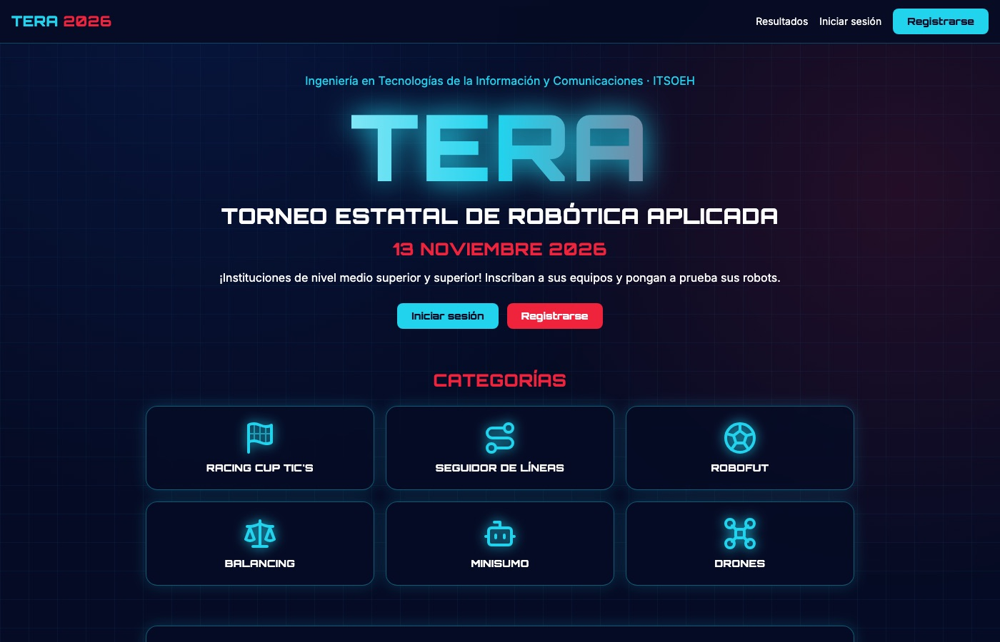

# TERA 2026 — Robotics Tournament Management Platform

Full stack web platform built to run a state robotics tournament end to end: team registration, payment validation, a judge's timer, round-based bracket draws and live results. It was used at the TERA 2026 tournament at ITSOEH.

**[Visit the live site →](https://tera-2026.onrender.com)**

## Features

- **Team registration** from the web or through bulk Excel import, with a preview before committing.
- **Payment validation:** only teams with a validated fee enter draws and rankings.
- **Roles and permissions:** participant, judge, admin and superuser, with token-based authentication.
- **Six categories** with two scoring modes: time-based (Racing Cup, Line Follower, Balancing, Drones) and match-based (Robofut, Minisumo).
- **Round-based brackets:** random draws that never repeat a matchup, fair byes for odd numbers of teams and a per-category lock so two judges cannot draw at the same time.
- **Rankings** with category-specific rules, shared ties and disqualifications.
- **Timer and result entry** for judges, plus a prize raffle for the closing ceremony.

## Performance

Load-tested with 600 concurrent viewers on the results page and 12 judges entering results at the same time, including simulated database failures during the test.

## Tech Stack

React · Vite · Tailwind CSS · Node.js · Express · PostgreSQL · Render · Neon

## Source Code

The source code is kept in a private repository. It can be shared on request.

---

**Author:** Rembrandt Alexander Calva Obregón · [Portfolio](https://alex-calva.github.io) · [LinkedIn](https://www.linkedin.com/in/alex-calva)
